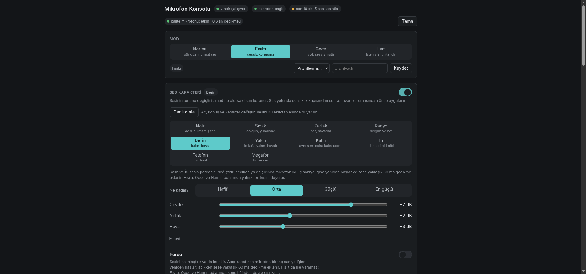
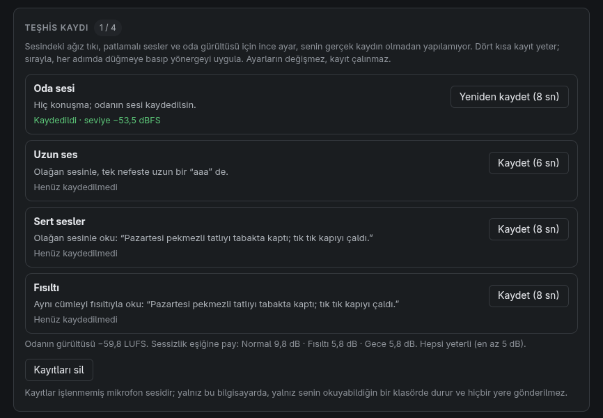

<p align="center"></p>

# mic-hifi

[English](README.md) · **Türkçe**

USB mikrofonun (**Nor-Tec streaming mic** ile test edildi) sesini PipeWire üzerinde katman katman işleyip **sanal bir mikrofon** olarak sunan yerel bir sistem ve onu yöneten küçük bir web paneli.
Ses bilgisayarından çıkmaz; bulut yok, hesap yok.

Zincir: alt kesim (95 Hz) → seviyeleyici (fısıltıyı yükseltir, sessizlikte donar) → kompresör → gürültü bastırma (DeepFilterNet3) → sessizlik kapısı →
ton (8 bantlı dengeleyici, hazır karakterler) → çok bantlı dinamik (dolgunluk, şişme, sertlik, ıslık) → doygunluk → tavan sınırlayıcı.
İsteğe bağlı: perde/ses yolu kaydırma ve ikinci, gecikmeli bir "kalite" mikrofonu (ekran kartında çalışan daha güçlü bir gürültü giderici).

## Yol haritası — ne yapılırsa nereye ulaşılır

Temizleme zinciri ve panel ölçümle kuruldu ve canlıda çalışıyor. Mikrofonun kendisi (kapsül, konum, cihaz içi işlem) ve dinleyici tarafının doğrulaması ise henüz ayrıştırılmadı. Tablodaki kazançlar **beklentidir, ölçülmüş sonuç değildir**.

| katman | bugün bilinen (yapıldı) | yapılmadı · test edilmedi · bilinmiyor | yapılınca nereye ulaşılır | nasıl / kaynak |
|---|---|---|---|---|
| **L1** akustik: kapsül, mesafe, oda | Gürültünün neredeyse tamamı 80 Hz altında; öz gürültü ~27 dB(A); 16 bit / ~17 kHz | Mikrofonun frekans yanıtı ölçülmedi (referans mikrofon yok) → ton düzeltmesi yok. Ağza mesafenin etkisi yalnız hesap (~+15 dB, ölçülmedi). Oda yankısı ele alınmadı | **En ucuz kazanç:** mikrofonu ağız kenarına 4–5 cm yaklaştırmak (bedava). Ölçülürse ton düzlenir, ses "kendi sesin" gibi duyulur | 5 dk mesafe ölçümü; referans mikrofon ya da bilinen kaynakla yanıt ölçümü |
| **L2** cihaz: USB mikrofonun içi | Halka mikrofonun kazancını cihaz kendi içinde ayarlıyor; cihazın sessiz tuşu panelde görünüyor | Cihaz içi otomatik kazanç / işlem tam karakterize edilmedi. Üretici kontrol kanalına **bilerek yazılmıyor** | Cihazın kendi ayarıyla zincirin birbiriyle "yarışması" önlenir | Yalnız okuma ve ölçüm; cihaza komut gönderilmez |
| **L3** Linux / PipeWire / yakalama | Sanal mikrofon; profil kayarsa bekçi kendiliğinden onarıyor; yeniden başlatma ~2,5 sn | Çok çekirdekli ağır yükte gürültü bastırıcı blok kaçırabiliyor (kısa kesinti) — **açık**; profil kaymasının kök nedeni adlandırılmadı | Yük altında da kesintisiz canlı kullanım | Bastırıcıyı ayrı bir işçi sürece taşımak (taşıyıcı tasarımı yalıtılmış örnekte test edildi) + uzun yük koşusu |
| **L4** temizleme zinciri | **Güçlü:** fısıltı SNR 8,6 → 27,1 dB; seviyeleyici, kompresör, DeepFilterNet3, kapı, bölünmüş bantlı ıslık kısma, dinamik EQ; çıkış hedefi −23 / −16 LUFS, gerçek tepe ≤ −1 dBTP | Yalnız Fısıltı modu kabul testinden geçti; Normal ve Gece değerleri ölçümle oturtulmadı. Ağız sesi / çıtırtı canlıda yok, oda yankısı giderme yok, eko iptali denendi ama bağlanmadı. Çoğu ayar kulakla doğrulanmadı | Stüdyoya yakın teslim; hoparlörle görüşmede eko iptali | Kendi sesinle test seti kaydı (~20 dk) + panelin teşhis kaydı |
| **L5** kalite hattı (ekran kartı) | İkinci, ~1 sn gecikmeli "kalite" mikrofonu canlıda (MossFormer2); kayıtlı dosyayı iyileştirme (`mic enhance`); çevrimdışı ölçümde DeepFilterNet'ten iyi (SNR 37,1 ↔ 30,7 dB) | Kulakla doğrulanmadı; kurulumu bu depoda belgelenmedi; ana mikrofon yapılmadı | Kayıt ve yayında, gecikmenin önemli olmadığı yerde daha temiz ses | Kurulum belgesi + kulak testi |
| **L6** ses karakteri, perde, dönüştürme | 10 karakter (Nötr, Sıcak, Parlak, Radyo, Derin, Yakın, Telefon, Megafon, Kalın, İri), yoğunluk, kendi karakterlerin; perde (Rubber Band) | Formant ayrı ayarlanmıyor; YZ ses dönüştürme yapılmadı | Kendi ses renginin değiştirilmesi; YZ ile başka bir sese dönüşme | Açık kaynak ses dönüştürme modelleri (lisans ve gecikme ölçülerek) |
| **L7** panel, kurulum, dağıtım | Panel, teşhis kaydı, profiller; mikrofon `mic device` ile seçiliyor; Apache-2.0; temiz yayın ağacı | Kurulum temiz bir makinede baştan sona yürünmedi; kurulum sihirbazı ertelendi; İngilizce arayüz yok; CI yok; DeepFilterNet zorunlu | Başkalarının kendi makinesinde kolayca kurup kullanması | Temiz makinede/VM'de kurulum yürüyüşü + sentetik sinyalle CI |

**Aşılamayacak tavan.** Ses kalitesindeki en büyük fark donanımdan gelir: öz gürültü ~27 dB(A) ve 16 bit / ~17 kHz. Yazılım gürültüyü sonradan bastırır, iyi bir mikrofon baştan üretmez; bu fark yazılımla kapanmaz. Gerçekçi hedef: görüşme ve yayın için temiz ses; stüdyo vokali bu mikrofonla ulaşılamaz.

**Açık kaynak tarafı.** Fısıltı kipi incelenen ticari ürünlerin hiçbirinde bulunamadı; zincir tamamen yerel ve PipeWire üzerinde. Mikrofon `mic device` ile seçildiği için yöntem başka USB mikrofonlara da uygulanabilir — ölçülen tek mikrofon olsa da.

**Plan:** en büyük iki kazanç hâlâ bedava: mikrofonu yaklaştırmak ve test seti kaydı. Sonra kesintisiz canlı kullanım (L3), sonra kulak doğrulaması ve kalite hattının belgelenmesi.

- [ ] **L1** mesafe ölçümü + frekans yanıtı
- [ ] **L2** cihaz içi kazancın karakterizasyonu (salt okuma)
- [ ] **L3** yük altında kesintisiz (bastırıcıyı ayrı işçiye taşı)
- [ ] **L4** Normal/Gece modlarını ölçümle oturt; ağız sesi, eko iptali
- [ ] **L5** kalite hattının kurulum belgesi + kulak testi
- [ ] **L6** formant + YZ ses dönüştürme
- [ ] **L7** temiz makinede kurulum yürüyüşü, İngilizce arayüz, CI

## Kim ne yapabilir — üretici ↔ kullanıcı

Bir mikrofonun sesini en iyi hâle getirmek için gereken bilginin bir kısmı **yalnız üreticide** vardır (kapsülün ölçümü, cihazın içindeki işlem), bir kısmını ise **kullanıcı kendisi** ölçebilir. Üretici paylaşmadıkça yazılım tahminle düzeltir; kullanıcı ölçtükçe boşluk kapanır.

### Üreticinin paylaşması gereken veriler

| veri | neden önemli | standart / nasıl |
|---|---|---|
| Frekans yanıtı (eksen üzerinde, belirtilen mesafede) ve yön karakteristiği (polar desen) | Ton düzeltmesinin tek sağlam temeli; bugün referans ölçüm olmadığı için ton düzeltilmiyor | Yankısız ortamda ölçüm, CSV olarak (ör. IEC 60268-4 yöntemleri) |
| Öz gürültü (dB(A)), hassasiyet (94 dB SPL'de dBFS), en yüksek SPL | Fısıltı gibi alçak seslerde ulaşılabilecek temizliğin tavanı | Veri sayfası değerleri |
| Gerçek ADC çözünürlüğü ve örnekleme hızı (USB tanımlayıcısında yazan değil, dönüştürücünün kendisi) | 16 bit / ~17 kHz sınırının donanımdan mı ayardan mı geldiği anlaşılır | Veri sayfası + USB ses sınıfı tanımlayıcısı |
| Cihaz içi işlem: otomatik kazanç, sınırlayıcı, gürültü kapısı, alçak kesim — ve kapatılabilir mi | Cihazın kendi otomatik kazancı yazılım zinciriyle "yarışır"; bu cihazda kazanç cihaz içinde ayarlanıyor | İşlem listesi + USB ses sınıfı denetimleri |
| Kontrol kanalı (HID) protokol belgesi | Kazanç, sessiz tuşu, ışık gibi ayarlar her platformdan güvenle yönetilir; belgesiz kanala yazmak riskli olduğu için bu proje yazmıyor | Açık protokol belgesi |
| Firmware sürümü ve güncelleme yolu | Ölçümler hangi sürüme ait, bilinir | Sürüm notları |

### Kullanıcının kendisinin yapabileceği testler (bu repo ile)

| test | ne söyler | nasıl | paylaşılabilecek veri |
|---|---|---|---|
| Durum kontrolü | Hangi mikrofon işleniyor, zincir çalışıyor mu, varsayılan giriş doğru mu | `bin/mic status` · `python3 tests/verify.py` | Kabul çıktısı |
| Oda sesi | Odanın gürültü tabanı — Fısıltı/Gece modunun yetip yetmediği | Panel → teşhis kaydı → "Oda sesi" | Ölçülen seviye (dBFS / LUFS) |
| Mesafe testi | Mikrofonu yaklaştırmanın kazancı (hesap ~+15 dB, ölçülmedi) | Aynı cümleyi 15 cm ve 5 cm'den kaydedip ölçmek | İki ölçümün farkı |
| Test seti kaydı | Fısıltı / alçak / normal ses × klavye / nefes; mod değerlerinin ölçümle oturtulması | Panelin teşhis kaydı adımları | Ölçüm sonuçları (ses dosyasının kendisi değil) |
| Teslim ölçüsü | Ses yüksekliği (LUFS) ve gerçek tepe — görüşme ve yayın hedefine uyuyor mu | Panel → "Kaydı ölç" | LUFS / dBTP değerleri |
| Önce/sonra dinleme | Ham ve temiz sesi aynı anda kaydedip sırayla dinlemek | `bin/mic ab 8` | Tercih notu |
| Kulak doğrulaması | Karakterler ve perde kendi sesinde nasıl duyuluyor | Panel → "Kulakla karşılaştır" | Geri bildirim |

**Gizlilik:** ses kayıtları bilgisayardan çıkmaz ve bu depoya girmez; paylaşılacak olan ölçüm sonuçlarıdır, sesin kendisi değil.

### Üreticiye öneriler — en düşük maliyetle en büyük kalite artışı

Maliyet ve kazanç tahminidir; bu mikrofonda ölçülmedi.

| öneri | ek maliyet | beklenen kazanç |
|---|---|---|
| Fabrika ölçümlerini (frekans yanıtı, öz gürültü, hassasiyet) yayımlamak | **Sıfır** — üretimde zaten ölçülüyor | Yazılım tonu doğru düzeltir; kullanıcı mikrofonun gerçek sınırını bilir |
| Cihazın ADC'si destekliyorsa 24 bit / 48 kHz'i USB üzerinden açmak | Yalnız firmware | Alçak seslerde daha fazla pay, daha geniş bant |
| Cihaz içi otomatik kazancı kapatılabilir yapmak (USB ses sınıfı denetimiyle) | Yalnız firmware | Yazılım zinciri öngörülebilir çalışır; kazanç "pompalaması" biter |
| Varsayılan alçak kesimi (~80 Hz) cihazda açmak | Yalnız firmware | Bu mikrofonda gürültünün neredeyse tamamı 80 Hz altında: uğultu ve masa titreşimi kaynağında kesilir |
| Kutuya köpük rüzgârlık / pop filtresi ve basit bir titreşim yalıtıcı koymak | Birkaç sent – birkaç euro | Patlamalı sesler ve masadan gelen titreşim azalır |
| Kontrol kanalını (HID) belgelemek | Belge yazmak | Ayarlar her platformdan güvenle yönetilir |
| Ön yükselteçte düşük gürültülü besleme (temiz regülatör) | Çok düşük parça maliyeti | Öz gürültü düşer — yazılımın sonradan bastırmak zorunda kaldığı gürültü kaynağında azalır |

## Ekran görüntüleri





## Test edilen donanım

| | |
|---|---|
| Mikrofon | **Nor-Tec streaming mic** (USB) — USB kimliği `3206:1278`, PipeWire'da `alsa_input.usb-Nor-Tec_streaming_mic_…` olarak görünür |
| Biçim | USB üzerinden 48 kHz, s16le, 2 kanal (ölçülen kullanılabilir bant ~17 kHz) |
| Sistem | Fedora 44 · PipeWire 1.6.8 · WirePlumber |

Başka USB mikrofonlarla da çalışır: `bin/mic device list` / `bin/mic device set` ile kendininkini seç. Başka bir modeli ölçtüysen sonuçlarla bir issue aç.

**Arama terimleri:** Nor-Tec streaming mic Linux · USB mikrofon gürültü bastırma PipeWire · DeepFilterNet LADSPA sanal mikrofon · fısıltı modu mikrofon · PipeWire filter-chain mikrofon EQ · Linux canlı ses değiştirici · Fedora mikrofon arka plan gürültüsü.

## Gereksinimler

- Linux, **PipeWire** (1.6.8 ile ölçüldü) ve WirePlumber; `pactl`, `pw-link`, `pw-cli`, `pw-record` komutları
- Python 3 (panel ve zincir yalnız standart kitaplığı kullanır); ölçüm araçları ve testler için `requirements.txt` (numpy, scipy)
- LSP Plugins LADSPA paketi (dağıtım deposundan, ör. Fedora'da `lsp-plugins-ladspa`)
- DeepFilterNet LADSPA eklentisi v0.5.6: yukarı akıştan indirilir ve `~/.local/lib/mic-hifi/libdeep_filter_ladspa.so` olarak konur; özeti `plugins.lock.json` içinde kilitlidir
- İsteğe bağlı: Rubber Band LADSPA eklentisi (perde için; Fedora'da `bash tools/install_rubberband.sh` kök yetkisi istemeden kurar)

Bu depo yukarıdaki üçüncü taraf bileşenlerin hiçbirini içermez (bkz. `NOTICE`).

## Kurulum

```bash
bin/mic device list                      # USB mikrofon adayları
bin/mic device set <kaynak adı> --label "Mikrofonum"   # tek aday varsa: bin/mic device auto
python3 tools/plugins.py check           # eklentilerin özeti kilitle aynı mı
python3 tools/gen_conf.py                # PipeWire yapılandırmasını üret (~/.config/mic-hifi/mic-clean.conf)
python3 tools/install_units.py --install # systemd kullanıcı birimlerini bu deponun konumuyla kur
systemctl --user enable --now mic-clean mic-prio mic-console
bin/mic console                          # panel adresi (ilk açılış için kişisel anahtarla)
python3 tests/verify.py                  # canlı zincirde doğrulama
```

Panel: `http://127.0.0.1:8767/` (yalnız bu bilgisayardan erişilir). Uygulamalarda mikrofon olarak "<etiket> (temiz)" seçilir.
Kaldırma: `systemctl --user disable --now mic-clean mic-prio mic-console mic-main mic-watch`.

Sınamalar (kişisel kayıt gerektirmeyenler): `python3 tests/test_console_server.py`, `python3 tests/test_device.py`, `python3 tests/test_install.py`,
`python3 tests/test_plugins.py`, `python3 tests/test_measure.py`, `python3 tests/test_conf_load.py`, `python3 tests/test_tone.py --fast`.

## Sınırlar

- Yalnız PipeWire; PulseAudio ya da JACK tek başına desteklenmez.
- **Tek bir makinede (Fedora 44) ve tek bir mikrofonda ölçüldü.** Kurulum adımları temiz bir makinede baştan sona yürünmedi; başka dağıtımlarda eklenti yolları farklı olabilir (`LADSPA_PATH` desteklenir).
- Gürültü bastırıcı sürekli yaklaşık üçte bir işlemci çekirdeği kullanır. Bellek yoğun ağır bir iş (ör. derleme) aynı anda koşarsa kısa ses kesintileri olabilir; panel son 10 dakikadaki sayıyı gösterir.
- Ses ayarları ölçümle seçildi; **kulakla doğrulama kullanıcıya aittir** — karakterler ve perde kendi sesinde nasıl duyulur, sen karar verirsin.
- Arayüz Türkçedir.
- "Kalite" mikrofonu (`mic-main`, `mic-watch`) ve `bin/mic enhance` ayrı bir Python ortamı, bir NVIDIA ekran kartı ve kullanıcının kendi indireceği bir model (MossFormer2_SE_48K, Apache-2.0) ister; bu depoda model ya da ortam yoktur ve kurulumu burada belgelenmemiştir. Kullanmayacaksan o iki birimi etkinleştirme.
- Tasarım notları ve ölçüm günlükleri bu depoda yayımlanmadı; koddaki `docs/...` göndermeleri o notlara aittir.

## Lisans

Apache-2.0 (`LICENSE`). Çalışma anında kullanılan üçüncü taraf bileşenler ve lisansları: `NOTICE`. Güvenlik bildirimi: `SECURITY.md`. Katkı: `CONTRIBUTING.md`.
